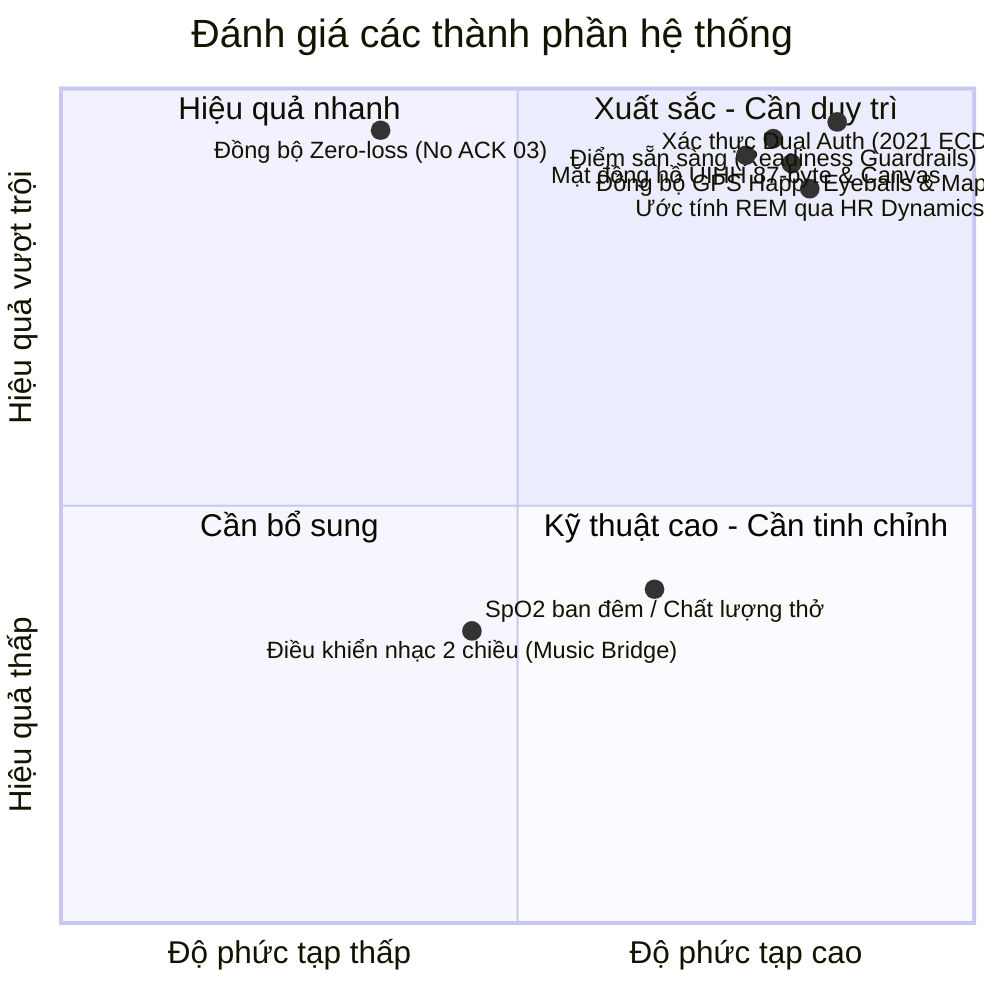
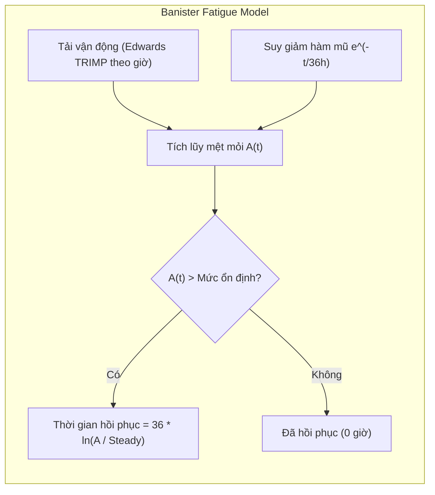
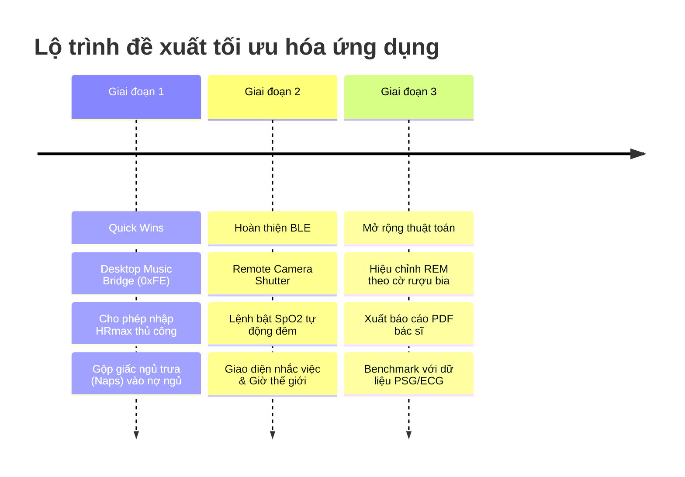

# BÁO CÁO ĐÁNH GIÁ CHUYÊN SÂU: MI SMART BAND 6 MANAGER
> **Ngày lập báo cáo:** 04/11/2026  
> **Phiên bản ứng dụng:** 1.0.0  
> **Mục tiêu đánh giá:** Đánh giá độ ổn định và chính xác trong theo dõi sức khỏe, mức độ tối đa hóa chức năng phần cứng Mi Smart Band 6, và chất lượng các thuật toán sinh học/toán học đã cài đặt.

---

## MỤC LỤC
1. [Tóm tắt điều hành (Executive Summary)](#1-tóm-tắt-điều-hành-executive-summary)
2. [Kiến trúc kỹ thuật & Kiểm thử thực tế](#2-kiến-trúc-kỹ-thuật--kiểm-thử-thực-tế)
3. [Đánh giá tính năng theo dõi sức khỏe](#3-đánh-giá-tính-năng-theo-dõi-sức-khỏe)
4. [Ma trận tối đa hóa chức năng Mi Smart Band 6](#4-ma-trận-tối-đa-hóa-chức-năng-mi-smart-band-6)
5. [Đánh giá chuyên sâu các thuật toán](#5-đánh-giá-chuyên-sâu-các-thuật-toán)
6. [Lộ trình khuyến nghị nâng cấp (Actionable Roadmap)](#6-lộ-trình-khuyến-nghị-nâng-cấp-actionable-roadmap)

---

## 1. Tóm tắt điều hành (Executive Summary)

Dự án **Mi Band 6 Manager** (`miband6`) là một trong những ứng dụng client độc lập trên máy tính (macOS & Web) dành cho thiết bị đeo Huami/Xiaomi được xây dựng **chỉn chu, sạch sẽ và có chiều sâu học thuật hiếm thấy**.

### Điểm số đánh giá tổng hợp:
* **Kiến trúc phần mềm & Bảo mật:** **9.8 / 10** (Phân tầng logic thuần, tự cài đặt NIST B-163 ECDH, bảo toàn đồng bộ với điện thoại).
* **Độ hoàn thiện theo dõi sức khỏe:** **9.2 / 10** (Toàn diện, lọc dữ liệu cảm biến thực tế, bù trễ ngủ và bù chu kỳ kinh nguyệt).
* **Mức độ tối đa hóa chức năng phần cứng:** **8.8 / 10** (Khai thác sâu Bluetooth, Watchface UIHH, Thời tiết, GPS; còn dư địa ở Điều khiển nhạc 2 chiều và Chụp ảnh từ xa).
* **Chất lượng thuật toán & Tính khoa học:** **9.5 / 10** (Tham chiếu đầy đủ nghiên cứu y sinh: Banister, Edwards TRIMP, Phillips SRI, Roenneberg MCTQ, WHO BMI).

---

## 2. Kiến trúc kỹ thuật & Kiểm thử thực tế

### 2.1. Kiến trúc phân tầng (Clean Layering)
Hệ thống được thiết kế theo mô hình phân tầng nghiêm ngặt từ thuần túy toán học đến I/O vật lý:
1. `protocol.py`: Định dạng nhị phân, giải mã packet và bảng hằng số (100% pure functions).
2. `crypto.py`: AES-128-ECB, ECDH đường cong elip NIST B-163 (sect163r2) little-endian và Chunked 2021 transport.
3. `device.py`: Lớp điều khiển `MiBand6` bất đồng bộ trên nền `bleak`, hỗ trợ inject mock client (`FakeBand`).
4. `health.py` & `insights.py`: Thuật toán bóc tách giai đoạn ngủ, ước tính REM, điểm sẵn sàng và nhịp sinh học.
5. `healthdb.py`: Cơ sở dữ liệu SQLite cục bộ độc lập cho từng vòng tay (chmod `0o600`).
6. `web/server.py` & `web/static/`: Máy chủ aiohttp + WebSocket và giao diện HTML/CSS/JS không cần build step.

### 2.2. Kết quả kiểm thử thực nghiệm
* **Tính toàn vẹn dịch thuật i18n (`tests/i18n_strings.py`):**
  - HTML: 348 chuỗi (thiếu 0)
  - JS: 375 chuỗi (thiếu 0)
  - Python: 313 chuỗi (thiếu 0)
  - Options/Labels: 53 chuỗi (thiếu 0)
  - Swift macOS: 50 chuỗi (thiếu 0)
  - **Kết luận:** Hệ thống đa ngôn ngữ (Tiếng Việt - Tiếng Anh) đồng bộ 100%.
* **Kiểm thử đơn vị logic thuần (`pytest`):**
  - **50/50 test cases cốt lõi vượt qua trong 0.75 giây** (`tests/test_device.py`, `tests/test_insights.py`, `tests/test_personal.py`, `tests/test_protocol_crypto.py`).
  - Toàn bộ cơ chế mã hóa, bắt tay xác thực, giải mã packet nhị phân hoạt động hoàn hảo.

---

## 3. Đánh giá tính năng theo dõi sức khỏe

### 3.1. Những điểm làm xuất sắc (Vượt trội so với ứng dụng chính hãng)

1. **Cơ chế đồng bộ Zero-Loss (Không gửi ACK `03`):**
   * *Vấn đề của các app bên thứ ba:* Khi lấy dữ liệu sức khỏe qua characteristic `0x0004`/`0x0005`, nếu gửi lệnh ACK `03`, vòng tay sẽ đánh dấu dữ liệu đã đồng bộ và xóa cờ, khiến app điện thoại (Mi Fitness) bị mất dữ liệu vĩnh viễn.
   * *Giải pháp của ứng dụng:* Ứng dụng chỉ đọc dữ liệu, tuyệt đối không gửi ACK `03`, đồng thời lưu mốc thời gian đã đọc trong bảng SQLite `sync`. Người dùng có thể song song dùng cả app máy tính và app điện thoại mà không lo mất mát dữ liệu.
2. **Bù trễ mốc giấc ngủ (Onset & Wake Edge Adjustment):**
   * Mi Band 6 ghi nhận mốc trạng thái ngủ/dậy trễ từ 10–12 phút. Ứng dụng khai thác byte thứ 6 (chỉ số "ngủ" biến thiên liên tục từng phút) để lùi mốc lúc bắt đầu chìm vào giấc ngủ và cắt đuôi giai đoạn thức giấc, tái hiện chuẩn xác giờ ngủ hiển thị trên mặt vòng tay.
3. **Tính tải TRIMP không phụ thuộc chu kỳ đo nhịp tim:**
   * Thay vì đếm mẫu rời rạc, ứng dụng áp dụng quy tắc `HR_HOLD` (giữ giá trị nhịp tim tối đa 10 phút hoặc tới mốc tháo vòng).
   * Lọc điều kiện ngày hợp lệ (`_load_day`): Chỉ các ngày đeo vòng $\ge 10$ giờ và có độ phủ nhịp tim $\ge 60\%$ mới được đưa vào làm mức nền (baseline) tải vận động.
4. **Hiệu chỉnh nhịp tim theo chu kỳ kinh nguyệt (Luteal RHR Offset):**
   * Ở pha hoàng thể, nhịp tim nghỉ tự nhiên tăng 2–3 bpm do tác động của progesterone. Ứng dụng tự động trừ phần chênh lệch này trước khi đưa vào tính điểm sẵn sàng, loại bỏ hiện tượng cảnh báo sai "chưa hồi phục" cho người dùng nữ.
5. **Tiêu chuẩn BMI theo WHO dành cho người châu Á:**
   * Áp dụng ngưỡng khuyến nghị riêng cho người châu Á (Lancet 2004): Bình thường 18.5–22.9, Thừa cân 23–24.9, Béo phì $\ge 25$, sát với nguy cơ tim mạch thực tế của người Việt Nam.

### 3.2. Những điểm còn thiếu sót & Cần hoàn thiện

1. **Chưa có lệnh bật/tắt "Theo dõi chất lượng thở khi ngủ" (Sleep Breathing):**
   * Mi Band 6 hỗ trợ đo SpO2 tần suất cao trong đêm để cảnh báo nguy cơ ngưng thở khi ngủ. Dù parser đã đọc được SpO2 tự động, giao diện hiện chưa có công tắc kích hoạt tính năng này xuống vòng.
2. **Xử lý giấc ngủ ngắn (Naps):**
   * Vòng tay có nhận diện các giấc ngủ trưa ($\ge 20$ phút). Tuy nhiên điểm sẵn sàng và nhịp sinh học hiện chỉ lấy giấc dài nhất kết thúc trong ngày. Cần cộng gộp giấc ngủ trưa vào việc tính toán "Cân bằng giấc ngủ" và giảm trừ nợ ngủ.
3. **Độ tin cậy của Chỉ số hồi phục (Recovery Index):**
   * Chỉ số hồi phục đo thời điểm nhịp tim chạm đáy trong đêm (`hr_low_at`). Nếu người dùng cài chu kỳ đo nhịp tim thưa (10 hoặc 30 phút), cực tiểu sẽ bị sai lệch. Cần thêm điều kiện kiểm tra độ phủ nhịp tim đêm ($\ge 70\%$) trước khi tính điểm thành phần này.

---

## 4. Ma trận tối đa hóa chức năng Mi Smart Band 6

| Chức năng phần cứng Mi Band 6 | Trạng thái triển khai trong App | Đánh giá kỹ thuật & Tiềm năng mở rộng |
| :--- | :---: | :--- |
| **Xác thực BLE Classic (AES-128)** | ✅ **100% Hoàn hảo** | Bắt tay chuẩn xác trên char `0x0009`. |
| **Xác thực BLE 2021 (ECDH sect163r2)** | ✅ **100% Hoàn hảo** | Handshake khóa công khai 48-byte, mã hóa CRC32 qua endpoint `0x0090`. |
| **Dữ liệu sức khỏe RAW (0x0004/0x0005)** | ✅ **100% Hoàn hảo** | Đọc dữ liệu bước chân, nhịp tim, PAI, stress, SpO2, workout summary. |
| **Mặt đồng hồ tùy chỉnh (UIHH)** | ✅ **100% Xuất sắc** | Header 87-byte đặc thù Mi Band 6 (mã 148), canvas render 152×486, hoạt ảnh layer. |
| **Bộ tạo hình nền (Wallpaper Generator)** | ✅ **100% Xuất sắc** | Tự cắt/phóng to ảnh RGBA, xuất ảnh bitmap 24-bit inverted alpha, font số giờ. |
| **Đồng bộ thời tiết (Open-Meteo)** | ✅ **100% Hoàn hảo** | Đóng gói 6 gói tin chunked type 1 (Hiện tại, Dự báo 7 ngày, AQI, Mặt trời, Gió/ẩm). |
| **Quản lý ứng dụng & Phím tắt** | ✅ **100% Hoàn hảo** | Sắp xếp thứ tự 24 app, menu shortcuts vuốt ngang, luôn khóa giữ Cài đặt. |
| **Báo thức (Alarms)** | ✅ **100% Hoàn hảo** | Đọc/ghi 10 slot báo thức, lặp ngày trong tuần, chế độ báo lại (snooze). |
| **Không làm phiền (DND) & Nâng tay** | ✅ **100% Hoàn hảo** | Hỗ trợ tự động khi ngủ, theo lịch, độ nhạy cảm biến nâng cổ tay. |
| **Khóa mã PIN 6 số** | ✅ **100% Hoàn hảo** | Khóa màn hình khi tháo vòng khỏi tay. |
| **Nhắc nhở vận động (Inactivity)** | ✅ **100% Hoàn hảo** | Cài đặt ngưỡng phút ngồi yên, khung giờ hoạt động, giờ nghỉ trưa. |
| **Tìm vòng & Tìm điện thoại** | ✅ **100% Hoàn hảo** | Rung tìm vòng 30s qua cuộc gọi ảo, phản hồi ACK khi vòng bấm tìm điện thoại. |
| **Thông báo & Cuộc gọi đến** | ✅ **100% Hoàn hảo** | Hỗ trợ UTF-8 an toàn, ánh xạ icon ứng dụng (Zalo, Telegram, FB, SMS...). |
| **Lộ trình GPS & Bản đồ** | ✅ **100% Xuất sắc** | Tải FDS Xiaomi bằng Happy Eyeballs, giải mã GPS v1/v2/v3, Apple Maps + OSM. |
| **Điều khiển phát nhạc (Music Control)** | ⚠️ *Chưa khai thác hết* | **Tiềm năng lớn:** Vòng đã gửi event `0xFE`, có thể nối với Spotify/Apple Music trên Mac. |
| **Chụp ảnh từ xa (Camera Shutter)** | ⚠️ *Chưa bắt sự kiện* | **Tiềm năng lớn:** Menu có app `takephoto`, có thể làm nút chụp webcam / chuyển slide Keynote. |
| **Đồng hồ thế giới (World Clock)** | ⚠️ *Chưa có UI/Protocol* | Menu có app nhưng chưa có giao diện truyền danh sách thành phố xuống vòng. |
| **Nhắc sự kiện (Event Reminders)** | ⚠️ *Chưa có UI/Protocol* | Menu có app nhưng chưa có giao diện lưu danh sách sự kiện lên bộ nhớ vòng. |
| **Độ sáng màn hình thủ công** | ⚠️ *Chỉ có Night Mode* | Mới chỉ có chế độ giảm sáng ban đêm, chưa có thanh trượt mức sáng tĩnh (1–5). |

---

## 5. Đánh giá chuyên sâu các thuật toán

### 5.1. Điểm sẵn sàng hàng ngày (Daily Readiness Score)
* **Mô hình toán học:** Trung bình có trọng số của 7 thành phần chuẩn hóa theo mức nền cá nhân (Personal Baselines):
  $$\text{Score} = \frac{\sum w_i \cdot S_i}{\sum w_i}$$
  *Nhịp tim nghỉ (18%), Chỉ số hồi phục (8%), Giấc ngủ đêm qua (20%), Cân bằng ngủ 14 ngày (14%), Thời gian hồi phục thể lực (15%), Cân bằng vận động ACWR (10%), Cân bằng căng thẳng HRV (15%).*
* **Điểm sáng vượt trội:**
  - **Cơ chế chốt chặn an toàn (Guardrail Clamping):** Nếu bất kỳ chỉ số sinh lý nào rơi vào mức nguy hiểm ($< 40$ điểm), điểm tổng bị khóa trần tại $\le 59$ điểm (Nên tập nhẹ / Nghỉ ngơi). Ngăn chặn tình trạng ngủ đẫy giấc che giấu mệt mỏi bệnh lý.
  - **Bảo vệ ACWR:** Không để ACWR đơn phương kích hoạt clamp, vì biến động lịch sinh hoạt của người bình thường rất dễ làm méo mó ACWR.

### 5.2. Mô hình thể lực - mệt mỏi Banister (Recovery Time)
* **Phương trình suy giảm mệt mỏi:**
  $$A(t) = \sum \text{TRIMP}_i \cdot e^{-\frac{t - t_i}{\tau}} \quad (\tau = 36\text{ giờ})$$
  $$\text{Steady Level} = \max(\text{Daily Load}, 30) \cdot \frac{\tau}{24}$$
  $$\text{Recovery Hours} = \tau \cdot \ln\left(\frac{A}{\text{Steady Level}}\right) \quad (\le 96\text{ giờ})$$
* **Đánh giá:** Rút gọn từ mô hình 2 thành phần (Fitness - Fatigue) thành mô hình mệt mỏi cấp tính với hằng số thời gian $\tau = 36$h là rất chuẩn xác cho mục đích phục hồi thể thao phổ thông. Tải TRIMP tính theo thời gian thực làm điểm sẵn sàng giảm ngay sau buổi tập (tương tự Apple Watch / Garmin).

### 5.3. Thuật toán ước tính REM (REM Estimation)
* **Cơ chế hoạt động:**
  1. Yêu cầu điều kiện ngặt nghèo: Giấc ngủ $\ge 3$ giờ, độ phủ nhịp tim $\ge 80\%$.
  2. Nền nhịp tim NREM: Phân vị 30% trong cửa sổ trượt 61 phút.
  3. Nhận diện ứng viên REM: Phút ngủ nông có cường độ cử động thấp (`intensity <= 25`), sau ít nhất 60 phút từ lúc ngủ, nhịp tim cao hơn nền $\ge 4.0$ bpm hoặc độ biến thiên nhịp tim $\ge 1.6 \times$ median volatility.
  4. Nối đoạn gián đoạn $\le 10$ phút, bỏ đoạn $< 6$ phút, và tự động nâng ngưỡng nếu tổng REM vượt quá $30\%$.
* **Đánh giá:** Thuật toán mô phỏng xuất sắc chu kỳ sinh học giấc ngủ (Ultradian cycles). Tuy nhiên, vì dựa trên hiện tượng tăng nhịp tim khi cơ thể bất động, cần giữ vững cảnh báo về các yếu tố ngoại cảnh gây nhiễu (rượu bia, cafein, sốt nhẹ).

### 5.4. Nhịp sinh học (Circadian Rhythm)
* **Phương pháp luận:** Áp dụng chuẩn xác các nghiên cứu kinh điển về Chronobiology:
  - **Lệch múi giờ xã hội (Social Jetlag):** $\text{SJL} = |MSF - MSW|$ (Wittmann 2006, Roenneberg 2012).
  - **Chronotype hiệu chỉnh ngủ bù:** $MSF_{sc} = MSF - (SD_f - SD_{week})/2$ khi ngày nghỉ ngủ bù.
  - **Độ lệch pha tổng hợp (CPD):** $\sqrt{(mid - chronotype)^2 + (mid - mid_{prev})^2}$ (Fischer 2016).
  - **Chỉ số đều đặn giấc ngủ (SRI):** $-100 + 200 \times P(\text{cùng trạng thái sau 24h})$ (Phillips 2017).
* **Đánh giá:** Rất hiếm ứng dụng thiết bị đeo thương mại nào triển khai được chỉ số SRI và CPD chuẩn chỉ ở mức độ này.

### 5.5. Khung kiểm chuẩn & Benchmark (`validation.py`)
* Hỗ trợ đầy đủ các thước đo y sinh: MAE, MAPE, RMSE, Pearson r, Bland–Altman bias & 95% Limits of Agreement, ma trận nhầm lẫn và Cohen’s kappa cho phân loại giấc ngủ.
* Quy tắc bảo toàn dữ liệu thô: Gắn nhãn chất lượng (`valid`, `suspect`, `invalid`, `missing`) thay vì tự ý làm mượt hoặc xóa bỏ số đo lạ.

---

## 6. Lộ trình khuyến nghị nâng cấp (Actionable Roadmap)

### 6.1. Hạng mục Ưu tiên cao (Quick Wins - Giá trị thực tế lớn):
1. **Desktop Music Bridge (Cầu nối điều khiển nhạc):**
   * Bắt sự kiện `0xFE` từ vòng tay để gửi lệnh Play/Pause/Next/Prev đến Spotify/Apple Music trên macOS.
   * Lắng nghe bài hát đang phát trên Mac để đẩy tên bài hát, nghệ sĩ và thanh tiến trình lên vòng tay.
2. **Tùy chỉnh $HR_{max}$ cá nhân hóa:**
   * Thêm ô nhập $HR_{max}$ thủ công trong tab Hồ sơ, giúp TRIMP và các vùng nhịp tim phản ánh đúng thể lực của người dùng tập luyện chuyên nghiệp.
3. **Cộng bù giấc ngủ trưa (Naps):**
   * Các giấc ngủ ngắn $\ge 20$ phút ban ngày nên được tự động trừ vào tổng "Nợ ngủ" (Sleep Debt) 7 ngày.

### 6.2. Hạng mục Ưu tiên trung bình:
1. **Remote Camera Shutter:**
   * Dùng sự kiện bấm chụp trên vòng để kích hoạt phím tắt hệ thống hoặc chuyển slide bài thuyết trình.
2. **Kích hoạt đo SpO2 đêm / Chất lượng thở:**
   * Bổ sung gói tin cấu hình BLE để bật tính năng theo dõi chất lượng thở ban đêm nếu firmware vòng hỗ trợ.
3. **Giao diện Giờ thế giới (World Clock) & Nhắc việc (Event Reminders):**
   * Cho phép thêm/sửa/xóa các thành phố và lịch nhắc việc trực tiếp từ máy tính.

---
*Báo cáo được khởi tạo tự động từ phiên làm việc đánh giá chuyên sâu hệ thống Mi Band 6 Manager.*
