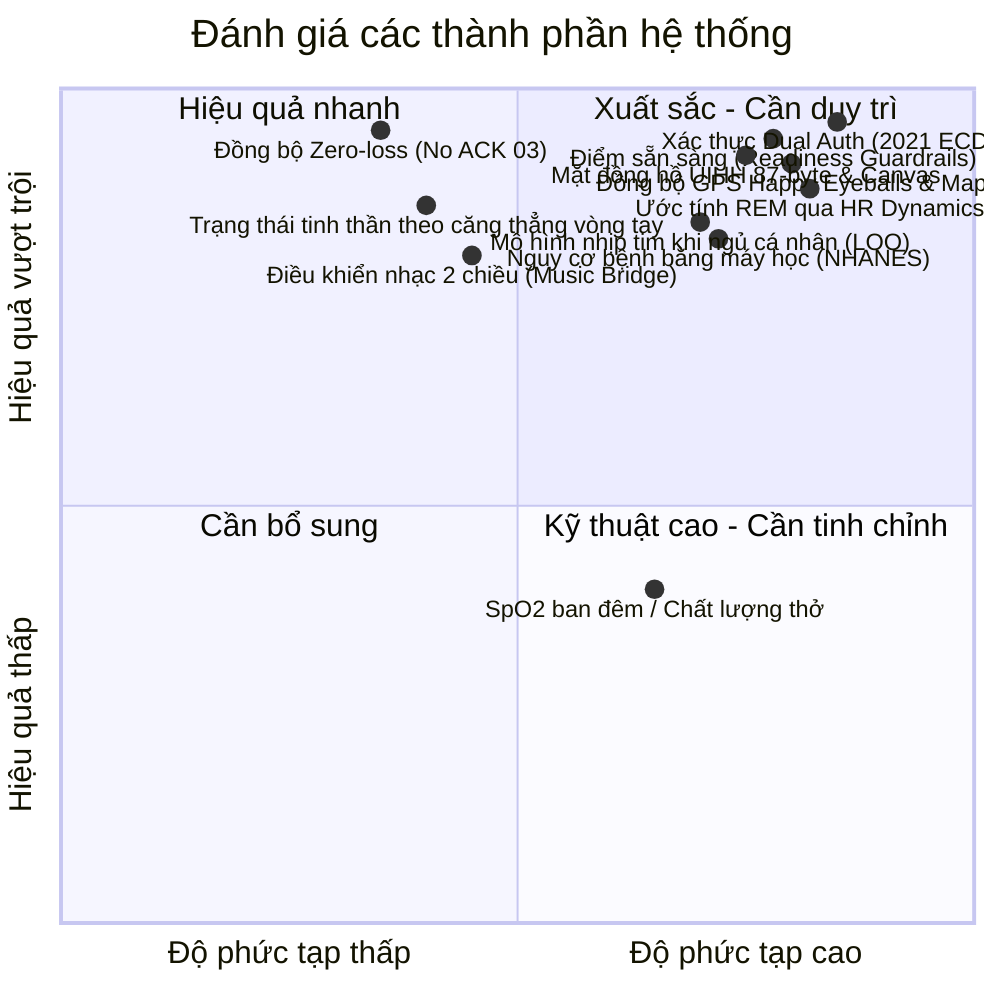
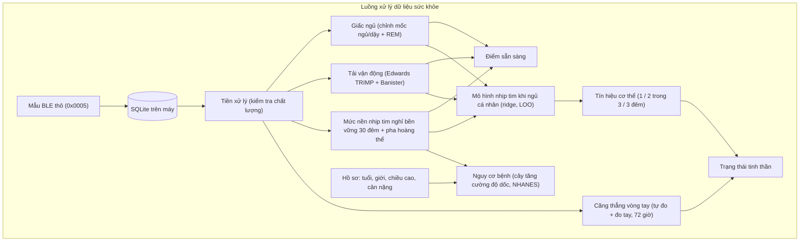
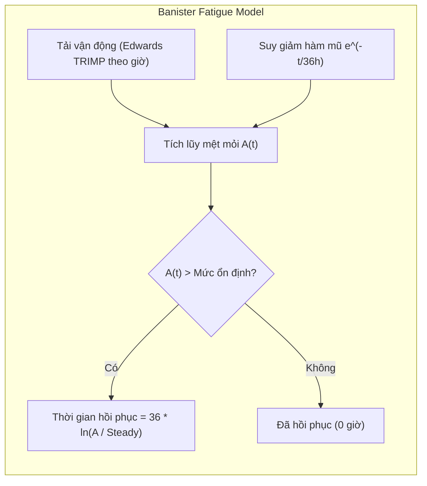
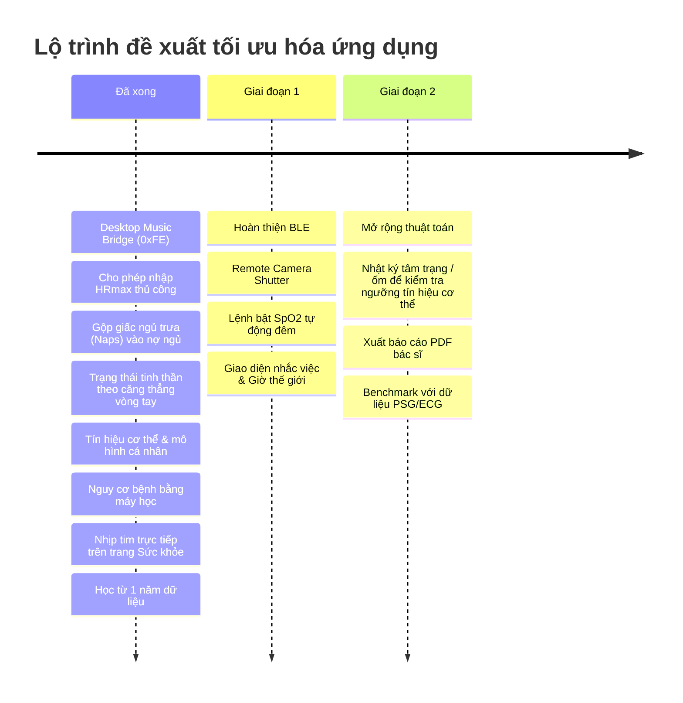

# BÁO CÁO ĐÁNH GIÁ CHUYÊN SÂU: MI SMART BAND 6 MANAGER
> **Ngày lập báo cáo:** 04/11/2026 (cập nhật cùng ngày sau khi sửa trạng thái tinh thần và thêm tín hiệu cơ thể)
> **Phiên bản ứng dụng:** 1.0.0
> **Mục tiêu đánh giá:** Đánh giá độ ổn định và chính xác trong theo dõi sức khỏe, mức độ tối đa hóa chức năng phần cứng Mi Smart Band 6, và chất lượng các thuật toán sinh học/toán học đã cài đặt.

> **Tóm tắt lần cập nhật.** Người dùng đo trên vòng tay thấy "Thư giãn" (26) nhưng thẻ Trạng thái tinh thần báo "Căng thẳng", mức căng 100. Nguyên nhân: yếu tố căng thẳng cần ít nhất 6 số đo tự động mỗi ngày và bỏ qua số đo tay, nên mức căng chỉ còn dựa vào nhịp tim nghỉ. Nay mức căng lấy từ chính các số đo căng thẳng của vòng tay (tự đo và đo tay), nhịp tim khi ngủ tăng được báo riêng là tín hiệu cơ thể, và một mô hình cá nhân giải thích các thay đổi của nhịp tim khi ngủ. Cũng trong ngày: mô hình nguy cơ bệnh (máy học, học từ 12.266 người lớn NHANES), nhịp tim trực tiếp hiện ngay trên trang Sức khỏe, và mô hình cá nhân học từ tới 1 năm lịch sử của người dùng. Thiếu sót 2 và 3 ở mục 3.2 cùng giai đoạn 1 của lộ trình đã được làm từ trước và được đánh dấu là xong. Bản tiếng Anh: [EVALUATION.md](EVALUATION.md).

---

## MỤC LỤC
1. [Tóm tắt điều hành (Executive Summary)](#1-tóm-tắt-điều-hành-executive-summary)
2. [Kiến trúc kỹ thuật & Kiểm thử thực tế](#2-kiến-trúc-kỹ-thuật--kiểm-thử-thực-tế)
3. [Đánh giá tính năng theo dõi sức khỏe](#3-đánh-giá-tính-năng-theo-dõi-sức-khỏe)
4. [Ma trận tối đa hóa chức năng Mi Smart Band 6](#4-ma-trận-tối-đa-hóa-chức-năng-mi-smart-band-6)
5. [Đánh giá chuyên sâu các thuật toán](#5-đánh-giá-chuyên-sâu-các-thuật-toán)
6. [Lộ trình khuyến nghị nâng cấp (Actionable Roadmap)](#6-lộ-trình-khuyến-nghị-nâng-cấp-actionable-roadmap)

---

## 1. Tóm tắt điều hành (Executive Summary)

Dự án **Mi Band 6 Manager** (`miband6`) là một trong những ứng dụng client độc lập trên máy tính (macOS & Web) dành cho thiết bị đeo Huami/Xiaomi được xây dựng **chỉn chu, sạch sẽ và có chiều sâu học thuật hiếm thấy**.

### Điểm số đánh giá tổng hợp:
* **Kiến trúc phần mềm & Bảo mật:** **9.8 / 10** (Phân tầng logic thuần, tự cài đặt NIST B-163 ECDH, bảo toàn đồng bộ với điện thoại).
* **Độ hoàn thiện theo dõi sức khỏe:** **9.2 / 10** (Toàn diện, lọc dữ liệu cảm biến thực tế, bù trễ ngủ và bù chu kỳ kinh nguyệt; trạng thái tinh thần theo đúng số đo căng thẳng của vòng tay; tín hiệu cơ thể từ nhịp tim khi ngủ nhiều đêm).
* **Mức độ tối đa hóa chức năng phần cứng:** **8.8 / 10** (Khai thác sâu Bluetooth, Watchface UIHH, Thời tiết, GPS, điều khiển nhạc 2 chiều với Apple Music, Spotify và nguồn phát macOS; còn dư địa ở Chụp ảnh từ xa, Giờ thế giới, Nhắc sự kiện và SpO2 ban đêm).
* **Chất lượng thuật toán & Tính khoa học:** **9.5 / 10** (Tham chiếu đầy đủ nghiên cứu y sinh: Banister, Edwards TRIMP, Phillips SRI, Roenneberg MCTQ, WHO BMI; mô hình cá nhân có kiểm chứng chéo, chỉ dùng khi tốt hơn mức nền).

---

## 2. Kiến trúc kỹ thuật & Kiểm thử thực tế

### 2.1. Kiến trúc phân tầng (Clean Layering)
Hệ thống được thiết kế theo mô hình phân tầng nghiêm ngặt từ thuần túy toán học đến I/O vật lý:
1. `protocol.py`: Định dạng nhị phân, giải mã packet và bảng hằng số (100% pure functions).
2. `crypto.py`: AES-128-ECB, ECDH đường cong elip NIST B-163 (sect163r2) little-endian và Chunked 2021 transport.
3. `device.py`: Lớp điều khiển `MiBand6` bất đồng bộ trên nền `bleak`, hỗ trợ inject mock client (`FakeBand`).
4. `health.py`, `insights.py`, `models.py` & `risk.py`: Thuật toán bóc tách giai đoạn ngủ, ước tính REM, điểm sẵn sàng, nhịp sinh học, trạng thái tinh thần, tín hiệu cơ thể, nhịp tim lúc nghỉ và kế hoạch ngủ. `models.py` là hồi quy ridge thuần Python có kiểm chứng chéo bỏ-một và đường học; `risk.py` đi theo các cây tăng cường độ dốc trong `risk_models.json` (không cần NumPy hay scikit-learn khi chạy, nên gói ứng dụng macOS arm64 vẫn nhỏ; huấn luyện chạy riêng bằng `tools/train_risk_models.py`).
5. `healthdb.py`: Cơ sở dữ liệu SQLite cục bộ độc lập cho từng vòng tay (chmod `0o600`).
6. `web/server.py` & `web/static/`: Máy chủ aiohttp + WebSocket và giao diện HTML/CSS/JS không cần build step.

### 2.2. Kết quả kiểm thử thực nghiệm
* **Tính toàn vẹn dịch thuật i18n (`tests/i18n_strings.py`):**
  - HTML: 379 chuỗi (thiếu 0)
  - JS: 451 chuỗi (thiếu 0)
  - Python: 407 chuỗi (thiếu 0)
  - Options/Labels: 53 chuỗi (thiếu 0)
  - Swift macOS: 50 chuỗi (thiếu 0)
  - **Kết luận:** Hệ thống đa ngôn ngữ (Tiếng Việt - Tiếng Anh) đồng bộ 100%.
* **Bộ kiểm thử (`pytest`):**
  - **222 kiểm thử đạt, 2 bỏ qua** (hai kiểm thử cần macOS: trình biên dịch Swift và môi trường script của macOS). Bộ kiểm thử được chạy ở múi giờ UTC và UTC+8; đã sửa hai kiểm thử phụ thuộc giờ trong ngày hoặc thời điểm đồng bộ chạy nền.
  - `tests/test_gui_demo.py` (bản Qt cũ) cần thư viện hiển thị của Qt, chạy trên máy có màn hình.
  - Kiểm thử mới: đúng trường hợp của người dùng (vòng tay đo thư giãn, nhịp tim khi ngủ +8), nhịp tim nghỉ một mình không bao giờ thành "Căng thẳng", mô hình cá nhân học được ảnh hưởng của giờ đi ngủ từ dữ liệu dạng vòng tay (qua toàn bộ đường xử lý) và từ 4 tháng lịch sử ngoài cửa sổ 60 ngày, đường học, kiểm chứng bỏ-một nhanh so với học lại từng lần, tín hiệu cơ thể nhiều đêm, các đợt nhịp tim lúc nghỉ, kế hoạch ngủ, mô hình nguy cơ bệnh (chất lượng đã kiểm chứng, tính đơn điệu, quy tắc yếu tố, hiệu chỉnh châu Á) và nhịp tim trực tiếp tới trang Sức khỏe.

---

## 3. Đánh giá tính năng theo dõi sức khỏe

### 3.1. Những điểm làm xuất sắc (Vượt trội so với ứng dụng chính hãng)

1. **Cơ chế đồng bộ Zero-Loss (Không gửi ACK `03`):**
   * *Vấn đề của các app bên thứ ba:* Khi lấy dữ liệu sức khỏe qua characteristic `0x0004`/`0x0005`, nếu gửi lệnh ACK `03`, vòng tay sẽ đánh dấu dữ liệu đã đồng bộ và xóa cờ, khiến app điện thoại (Mi Fitness) bị mất dữ liệu vĩnh viễn.
   * *Giải pháp của ứng dụng:* Ứng dụng chỉ đọc dữ liệu, tuyệt đối không gửi ACK `03`, đồng thời lưu mốc thời gian đã đọc trong bảng SQLite `sync`. Người dùng có thể song song dùng cả app máy tính và app điện thoại mà không lo mất mát dữ liệu.
2. **Bù trễ mốc giấc ngủ (Onset & Wake Edge Adjustment):**
   * Mi Band 6 ghi nhận mốc trạng thái ngủ/dậy trễ từ 10–12 phút. Ứng dụng khai thác byte thứ 6 (chỉ số "ngủ" biến thiên liên tục từng phút) để lùi mốc lúc bắt đầu chìm vào giấc ngủ và cắt đuôi giai đoạn thức giấc, tái hiện chuẩn xác giờ ngủ hiển thị trên mặt vòng tay.
3. **Tính tải TRIMP không phụ thuộc chu kỳ đo nhịp tim:**
   * Thay vì đếm mẫu rời rạc, ứng dụng áp dụng quy tắc `HR_HOLD` (giữ giá trị nhịp tim tối đa 10 phút hoặc tới mốc tháo vòng).
   * Lọc điều kiện ngày hợp lệ (`_load_day`): Chỉ các ngày đeo vòng $\ge 10$ giờ và có độ phủ nhịp tim $\ge 60\%$ mới được đưa vào làm mức nền (baseline) tải vận động.
4. **Hiệu chỉnh nhịp tim theo chu kỳ kinh nguyệt (Luteal RHR Offset):**
   * Ở pha hoàng thể, nhịp tim nghỉ tự nhiên tăng 2–3 bpm do tác động của progesterone. Ứng dụng tự động trừ phần chênh lệch này trước khi đưa vào tính điểm sẵn sàng, loại bỏ hiện tượng cảnh báo sai "chưa hồi phục" cho người dùng nữ.
5. **Tiêu chuẩn BMI theo WHO dành cho người châu Á:**
   * Áp dụng ngưỡng khuyến nghị riêng cho người châu Á (Lancet 2004): Bình thường 18.5–22.9, Thừa cân 23–24.9, Béo phì $\ge 25$, sát với nguy cơ tim mạch thực tế của người Việt Nam.
6. **Trạng thái tinh thần bám theo chỉ số căng thẳng của vòng tay:**
   * *Thực tế y sinh:* Vòng tay tính chỉ số căng thẳng từ HRV, thước đo trực tiếp của trạng thái căng thần kinh tự chủ. Nhịp tim khi ngủ tăng có nhiều nguyên nhân thể chất (rượu bia, ăn khuya, ngủ muộn, tập nặng, sắp ốm).
   * *Giải pháp:* Mức căng dùng mọi số đo 72 giờ qua, cả tự đo lẫn đo tay, số đo mới nặng hơn và so với mức thường của chính người dùng. Nhịp tim khi ngủ chỉ củng cố khi vòng tay cũng đo thấy căng; một mình nó bị giới hạn dưới ngưỡng "căng" và được báo là dấu hiệu thể chất.
7. **Tín hiệu cơ thể với mô hình cá nhân:**
   * *Thực tế y sinh:* Nhịp tim nghỉ tăng vài đêm trước và trong khi nhiễm bệnh (Mishra và cộng sự 2020, Quer và cộng sự 2021).
   * *Giải pháp:* Nhịp tim khi ngủ 3 đêm gần nhất được so với mức nền bền vững của người dùng (trung vị, độ lệch chuẩn từ MAD); cao 2 trong 3 đêm là "nên chú ý", 3 đêm liền là "cần lưu ý". Hồi quy ridge học xem giờ đi ngủ, độ dài giấc ngủ và tải vận động làm nhịp tim khi ngủ của chính người dùng thay đổi bao nhiêu, để chỉ báo phần không giải thích được.
8. **Nhịp tim lúc nghỉ và giấc ngủ tối nay:**
   * Các đợt nhịp tim kiểu Apple Watch (≥ 120 hoặc < 40 nhịp/phút kéo dài ≥ 10 phút lúc thức, ngồi yên, ngoài buổi tập) nằm trong phân tích sức khỏe. Kế hoạch ngủ tính ngược từ giờ dậy quen thuộc, bù dần nợ ngủ.
9. **Nguy cơ bệnh bằng máy học:**
   * Cây tăng cường độ dốc học từ 12.266 người lớn NHANES 2009–2012 ước tính khả năng hiện đã mắc tiểu đường (được chẩn đoán) và huyết áp lúc nghỉ ≥ 140/90 từ tuổi, giới, chiều cao, BMI và 30 ngày số đo của vòng tay, hiệu chỉnh cho người châu Á và giải thích bằng so sánh với người lành mạnh cùng tuổi. Các bệnh đoán kém hơn (cholesterol, HDL thấp, sàng lọc trầm cảm; AUC kiểm chứng < 0,70) đã thử và bỏ.
10. **Nhịp tim trực tiếp và thống kê không lệch theo chu kỳ đo:**
   * Số đo khi theo dõi liên tục được lưu theo phút và vẽ ngay trên trang Sức khỏe, lấp các phút vòng tay không đo. Trung bình trong ngày và nhịp tim lúc nghỉ tính theo thời gian, nên một giờ theo dõi bên máy tính không lấn át cả ngày đo 10 phút một lần, và vài bước đếm nhầm khi gõ phím không làm hỏng việc nhận ra lúc ngồi yên.
11. **Mô hình cá nhân học từ lịch sử dài:**
   * Mỗi ngày đã trọn được lưu gọn trong bảng `daily`, nên mô hình cá nhân học từ tới 1 năm (dữ liệu cũ được lấp dần 45 ngày mỗi lần), kèm đường học cho 1 tuần tới 1 năm dữ liệu.

### 3.2. Những điểm còn thiếu sót & Cần hoàn thiện

1. **Chưa có lệnh bật/tắt "Theo dõi chất lượng thở khi ngủ" (Sleep Breathing) (còn mở):**
   * Mi Band 6 hỗ trợ đo SpO2 tần suất cao trong đêm để cảnh báo nguy cơ ngưng thở khi ngủ. Dù parser đã đọc được SpO2 tự động, giao diện hiện chưa có công tắc kích hoạt tính năng này xuống vòng.
2. **Xử lý giấc ngủ ngắn (Naps) (đã xong):**
   * Các giấc ngủ ngắn đã kết thúc từ 20 phút được tính một lần theo ngày thức dậy vào cân bằng giấc ngủ và nợ ngủ 7 ngày; trạng thái tinh thần và kế hoạch ngủ dùng cùng tổng này.
3. **Độ tin cậy của Chỉ số hồi phục (Recovery Index) (đã xong):**
   * Chỉ số hồi phục cần số đo nhịp tim hợp lệ ở ít nhất 70% số phút ngủ, ít nhất 30 số đo và cửa sổ 5 phút liền nhau (`RECOVERY_MIN_HR_COVERAGE`).
4. **Phụ thuộc vào số đo căng thẳng (mới, đã giảm thiểu):**
   * Không bật theo dõi căng thẳng cả ngày thì trạng thái tinh thần dựa trên ít số đo. Thẻ ghi rõ đã dùng bao nhiêu số đo, hạ độ tin cậy và nhắc bật Theo dõi căng thẳng.
5. **Các ngưỡng chưa được kiểm chứng lâm sàng (mới):**
   * Cách quy đổi mức căng, quy tắc tín hiệu cơ thể, ngưỡng nhịp tim lúc nghỉ và quy tắc kế hoạch ngủ là lựa chọn thiết kế, ghi trong `docs/suc-khoe.md`. Mô hình cá nhân cần ít nhất 21 đêm và chưa được so với kết quả thật (tâm trạng tự ghi, bệnh được chẩn đoán).

---

## 4. Ma trận tối đa hóa chức năng Mi Smart Band 6

| Chức năng phần cứng Mi Band 6 | Trạng thái triển khai trong App | Đánh giá kỹ thuật & Tiềm năng mở rộng |
| :--- | :---: | :--- |
| **Xác thực BLE Classic (AES-128)** | ✅ **100% Hoàn hảo** | Bắt tay chuẩn xác trên char `0x0009`. |
| **Xác thực BLE 2021 (ECDH sect163r2)** | ✅ **100% Hoàn hảo** | Handshake khóa công khai 48-byte, mã hóa CRC32 qua endpoint `0x0090`. |
| **Dữ liệu sức khỏe RAW (0x0004/0x0005)** | ✅ **100% Hoàn hảo** | Đọc dữ liệu bước chân, nhịp tim, PAI, stress, SpO2, workout summary. |
| **Căng thẳng (tự đo + đo tay)** | ✅ **100% Hoàn hảo** | Lấy cả hai loại; biểu đồ căng thẳng, phân tích sức khỏe và trạng thái tinh thần đều dùng cả hai. Bật theo dõi căng thẳng cả ngày ở Cài đặt vòng tay → Sức khỏe. |
| **Mặt đồng hồ tùy chỉnh (UIHH)** | ✅ **100% Xuất sắc** | Header 87-byte đặc thù Mi Band 6 (mã 148), canvas render 152×486, hoạt ảnh layer. |
| **Bộ tạo hình nền (Wallpaper Generator)** | ✅ **100% Xuất sắc** | Tự cắt/phóng to ảnh RGBA, xuất ảnh bitmap 24-bit inverted alpha, font số giờ. |
| **Đồng bộ thời tiết (Open-Meteo)** | ✅ **100% Hoàn hảo** | Đóng gói 6 gói tin chunked type 1 (Hiện tại, Dự báo 7 ngày, AQI, Mặt trời, Gió/ẩm). |
| **Quản lý ứng dụng & Phím tắt** | ✅ **100% Hoàn hảo** | Sắp xếp thứ tự 24 app, menu shortcuts vuốt ngang, luôn khóa giữ Cài đặt. |
| **Báo thức (Alarms)** | ✅ **100% Hoàn hảo** | Đọc/ghi 10 slot báo thức, lặp ngày trong tuần, chế độ báo lại (snooze). |
| **Không làm phiền (DND) & Nâng tay** | ✅ **100% Hoàn hảo** | Hỗ trợ tự động khi ngủ, theo lịch, độ nhạy cảm biến nâng cổ tay. |
| **Khóa mã PIN 6 số** | ✅ **100% Hoàn hảo** | Khóa màn hình khi tháo vòng khỏi tay. |
| **Nhắc nhở vận động (Inactivity)** | ✅ **100% Hoàn hảo** | Cài đặt ngưỡng phút ngồi yên, khung giờ hoạt động, giờ nghỉ trưa. |
| **Tìm vòng & Tìm điện thoại** | ✅ **100% Hoàn hảo** | Rung tìm vòng 30s qua cuộc gọi ảo, phản hồi ACK khi vòng bấm tìm điện thoại. |
| **Thông báo & Cuộc gọi đến** | ✅ **100% Hoàn hảo** | Hỗ trợ UTF-8 an toàn, ánh xạ icon ứng dụng (Zalo, Telegram, FB, SMS...). |
| **Lộ trình GPS & Bản đồ** | ✅ **100% Xuất sắc** | Tải FDS Xiaomi bằng Happy Eyeballs, giải mã GPS v1/v2/v3, Apple Maps + OSM. |
| **Điều khiển phát nhạc (Music Control)** | ✅ **Đã hoàn thiện** | Sự kiện nhạc của vòng tay (`0xFE`) điều khiển Apple Music, Spotify hoặc nguồn phát của macOS (ví dụ YouTube trong Chrome); tên bài, nghệ sĩ và trạng thái phát được gửi lại khi mục Nhạc trên vòng tay đang mở. Mặc định tắt (Cài đặt ứng dụng). |
| **Chụp ảnh từ xa (Camera Shutter)** | ⚠️ *Chưa bắt sự kiện* | Mới có mục `takephoto` trên menu vòng tay; có thể làm nút chụp webcam / chuyển slide Keynote. |
| **Đồng hồ thế giới (World Clock)** | ⚠️ *Chưa có UI/Protocol* | Menu có app nhưng chưa có giao diện truyền danh sách thành phố xuống vòng. |
| **Nhắc sự kiện (Event Reminders)** | ⚠️ *Chưa có UI/Protocol* | Menu có app nhưng chưa có giao diện lưu danh sách sự kiện lên bộ nhớ vòng. |
| **Độ sáng màn hình thủ công** | ⚠️ *Chỉ có Night Mode* | Mới chỉ có chế độ giảm sáng ban đêm, chưa có thanh trượt mức sáng tĩnh (1–5). |

---

## 5. Đánh giá chuyên sâu các thuật toán

### 5.1. Điểm sẵn sàng hàng ngày (Daily Readiness Score)
* **Mô hình toán học:** Trung bình có trọng số của 7 thành phần chuẩn hóa theo mức nền cá nhân (Personal Baselines):
  $$\text{Score} = \frac{\sum w_i \cdot S_i}{\sum w_i}$$
  *Nhịp tim nghỉ (18%), Chỉ số hồi phục (8%), Giấc ngủ đêm qua (20%), Cân bằng ngủ 14 ngày (14%), Thời gian hồi phục thể lực (15%), Cân bằng vận động ACWR (10%), Cân bằng căng thẳng HRV (15%).*
* **Mức nền nhịp tim nghỉ:** trung vị tối đa 30 đêm trước, độ lệch chuẩn = 1,4826 × MAD (tối thiểu 2 nhịp/phút), nên vài đêm ốm hay uống rượu trong mức nền không kéo lệch nó; một đêm cần ít nhất 10 số đo nhịp tim.
* **Điểm sáng vượt trội:**
  - **Cơ chế chốt chặn an toàn (Guardrail Clamping):** Nếu bất kỳ chỉ số sinh lý nào rơi vào mức nguy hiểm ($< 40$ điểm), điểm tổng bị khóa trần tại $\le 59$ điểm (Nên tập nhẹ / Nghỉ ngơi). Ngăn chặn tình trạng ngủ đẫy giấc che giấu mệt mỏi bệnh lý.
  - **Bảo vệ ACWR:** Không để ACWR đơn phương kích hoạt clamp, vì biến động lịch sinh hoạt của người bình thường rất dễ làm méo mó ACWR.

### 5.2. Mô hình thể lực - mệt mỏi Banister (Recovery Time)
* **Phương trình suy giảm mệt mỏi:**
  $$A(t) = \sum \text{TRIMP}_i \cdot e^{-\frac{t - t_i}{\tau}} \quad (\tau = 36\text{ giờ})$$
  $$\text{Steady Level} = \max(\text{Daily Load}, 30) \cdot \frac{\tau}{24}$$
  $$\text{Recovery Hours} = \tau \cdot \ln\left(\frac{A}{\text{Steady Level}}\right) \quad (\le 96\text{ giờ})$$
* **Đánh giá:** Rút gọn từ mô hình 2 thành phần (Fitness - Fatigue) thành mô hình mệt mỏi cấp tính với hằng số thời gian $\tau = 36$h là rất chuẩn xác cho mục đích phục hồi thể thao phổ thông. Tải TRIMP tính theo thời gian thực làm điểm sẵn sàng giảm ngay sau buổi tập (tương tự Apple Watch / Garmin). Kết quả của hôm nay được tính lại mỗi giờ, kể cả khi vòng tay không kết nối.

### 5.3. Thuật toán ước tính REM (REM Estimation)
* **Cơ chế hoạt động:**
  1. Yêu cầu điều kiện ngặt nghèo: Giấc ngủ $\ge 3$ giờ, độ phủ nhịp tim $\ge 80\%$.
  2. Nền nhịp tim NREM: Phân vị 30% trong cửa sổ trượt 61 phút.
  3. Nhận diện ứng viên REM: Phút ngủ nông có cường độ cử động thấp (`intensity <= 25`), sau ít nhất 60 phút từ lúc ngủ, nhịp tim cao hơn nền $\ge 4.0$ bpm hoặc độ biến thiên nhịp tim $\ge 1.6 \times$ median volatility.
  4. Nối đoạn gián đoạn $\le 10$ phút, bỏ đoạn $< 6$ phút, và tự động nâng ngưỡng nếu tổng REM vượt quá $30\%$.
* **Đánh giá:** Thuật toán mô phỏng xuất sắc chu kỳ sinh học giấc ngủ (Ultradian cycles). Tuy nhiên, vì dựa trên hiện tượng tăng nhịp tim khi cơ thể bất động, cần giữ vững cảnh báo về các yếu tố ngoại cảnh gây nhiễu (rượu bia, cafein, sốt nhẹ). Từ bản cập nhật firmware ngày 03/11/2026, vòng tay ghi byte REM; khi có, ứng dụng dùng byte này thay cho ước tính.

### 5.4. Nhịp sinh học (Circadian Rhythm)
* **Phương pháp luận:** Áp dụng chuẩn xác các nghiên cứu kinh điển về Chronobiology:
  - **Lệch múi giờ xã hội (Social Jetlag):** $\text{SJL} = |MSF - MSW|$ (Wittmann 2006, Roenneberg 2012).
  - **Chronotype hiệu chỉnh ngủ bù:** $MSF_{sc} = MSF - (SD_f - SD_{week})/2$ khi ngày nghỉ ngủ bù.
  - **Độ lệch pha tổng hợp (CPD):** $\sqrt{(mid - chronotype)^2 + (mid - mid_{prev})^2}$ (Fischer 2016).
  - **Chỉ số đều đặn giấc ngủ (SRI):** $-100 + 200 \times P(\text{cùng trạng thái sau 24h})$ (Phillips 2017), chỉ tính các phút có đeo vòng.
* **Đánh giá:** Rất hiếm ứng dụng thiết bị đeo thương mại nào triển khai được chỉ số SRI và CPD chuẩn chỉ ở mức độ này.

### 5.5. Khung kiểm chuẩn & Benchmark (`validation.py`)
* Hỗ trợ đầy đủ các thước đo y sinh: MAE, MAPE, RMSE, Pearson r, Bland–Altman bias & 95% Limits of Agreement, ma trận nhầm lẫn và Cohen’s kappa cho phân loại giấc ngủ.
* Quy tắc bảo toàn dữ liệu thô: Gắn nhãn chất lượng (`valid`, `suspect`, `invalid`, `missing`) thay vì tự ý làm mượt hoặc xóa bỏ số đo lạ.

### 5.6. Trạng thái tinh thần
* **Bằng chứng căng thẳng:** mỗi số đo 72 giờ qua (tự đo và đo tay) có trọng số $0.5^{\text{tuổi}/24\text{h}}$. Mức căng $= \text{clamp}((\bar{s} - 35)/50) + 0.5 \cdot \text{tỉ lệ số đo cao}$, nên mức "trung bình" của vòng tay (60) cho 0,5; cộng thêm tối đa 0,25 khi cao hơn hẳn mức thường của người dùng.
* **Nhịp tim nghỉ:** chỉ củng cố khi mức căng từ 0,3; không có số đo căng thẳng thì tối đa 0,45, dưới ngưỡng "căng" 0,5.
* **Trạng thái:** quá tải / căng thẳng / mệt mỏi / thư thái / cân bằng theo mức căng và mức mệt (giấc ngủ, nhịp sinh học); "thư thái" còn cần nhịp tim khi ngủ không cao. Độ tin cậy theo số số đo căng thẳng và số đêm gần đây.

### 5.7. Tín hiệu cơ thể & mô hình nhịp tim khi ngủ cá nhân
* **Mô hình:** $d_k = a + \sum_j b_j x_{kj}$, với $d_k$ là độ lệch nhịp tim khi ngủ của một đêm so với mức nền của chính đêm đó, $x$ là tải hôm trước so với thường lệ, tải trong 4 giờ trước khi ngủ, đi ngủ muộn hơn và ngủ ngắn hơn (0 = đêm bình thường). Phạt ridge 4 trên đặc trưng đã chuẩn hóa; bỏ các đêm lệch quá 3,5 độ lệch chuẩn bền vững.
* **Điều kiện dùng:** ít nhất 21 đêm học và sai số tuyệt đối trung bình bỏ-một nhỏ hơn mô hình chỉ có hệ số chặn ít nhất 5%; nếu không, ứng dụng chỉ so với mức nền và ghi rõ điều đó. Mức ảnh hưởng chỉ báo khi $|t| \ge 2$.
* **Tín hiệu:** một đêm cao khi lệch $\ge 3$ nhịp/phút và $\ge 2$ độ lệch chuẩn (phần không giải thích được nếu mô hình đang dùng): 1 đêm "ổn", 2 trong 3 đêm "nên chú ý", 3 đêm liền "cần lưu ý".

### 5.8. Nhịp tim lúc nghỉ & giấc ngủ tối nay
* **Đợt nhịp tim lúc nghỉ:** các số đo liền nhau cách nhau ≤ 10 phút, cùng ≥ 120 hoặc < 40 nhịp/phút, kéo dài ≥ 10 phút, không có bước nào trong 5 phút trước mỗi số đo, ngoài giấc ngủ và ngoài buổi tập cộng 30 phút. Chỉ kết luận "không có bất thường" khi tuần có ≥ 144 số đo lúc nghỉ đủ dày.
* **Kế hoạch ngủ:** nhu cầu ngủ theo tuổi cộng 1/3 nợ ngủ 7 ngày (tối đa 60 phút), tính ngược từ trung vị giờ dậy của cùng loại ngày, trừ thời gian thức giữa đêm thường gặp và 15 phút để thiếp đi; không sớm hơn giờ ngủ quen thuộc quá 60 phút.

### 5.9. Mô hình nguy cơ bệnh
* **Dữ liệu & nhãn:** NHANES 2009–2012, người lớn ≥ 18 tuổi, không mang thai (12.266 người; 818 người châu Á). Tiểu đường = được bác sĩ chẩn đoán; tăng huyết áp = huyết áp trung bình trong buổi khám ≥ 140/90 mmHg.
* **Mô hình:** `HistGradientBoostingClassifier` có ràng buộc đơn điệu (tuổi, BMI, nhịp tim lúc nghỉ ↑; số ngày vận động ↓), siêu tham số theo log loss kiểm chứng chéo 5 lớp; kiểm chứng theo thời gian 2009–10 → 2011–12: tiểu đường AUC 0,794 (0,777–0,808), tăng huyết áp 0,758 (0,743–0,772); độ dốc hiệu chuẩn 0,94 và 1,02. Mô hình cuối học lại trên cả hai chu kỳ.
* **Hiệu chỉnh châu Á:** độ dịch logit out-of-fold ở người châu Á, co theo sai số chuẩn (James–Stein): tiểu đường +0,35 (thật 11,0% so với đoán 8,1%), tăng huyết áp ≈ 0.
* **Giải thích:** xác suất khi một yếu tố thay đổi được (BMI, nhịp tim lúc nghỉ, giấc ngủ, số ngày vận động) về mức lành mạnh, chỉ liệt kê khi yếu tố nằm ngoài khoảng lành mạnh và làm nguy cơ cao hơn.

### 5.10. Lịch sử dài và dữ liệu trực tiếp
* **Đường học:** $\text{MAE}_W = \frac{1}{|T|}\sum_{k\in T} |y_k - \hat{y}_k^{(W)}|$, với $\hat{y}_k^{(W)}$ chỉ học từ các đêm trong $(d_k - W, d_k)$, $W \in \{7, 30, 90, 180, 365\}$ ngày, $T$ = 30 đêm gần nhất.
* **Bỏ-một nhanh:** $e_i^{LOO} = e_i / (1 - h_{ii})$, $h_{ii} = 1/n + z_i^\top (Z^\top Z + \lambda I)^{-1} z_i$.
* **Nhịp tim trực tiếp:** gộp số đo Bluetooth theo phút; phút đã có số của vòng tay thì dùng số đó; trung bình theo thời gian, mỗi số đo giữ tối đa 10 phút.

---

## 6. Lộ trình khuyến nghị nâng cấp (Actionable Roadmap)

### 6.1. Đã hoàn thành kể từ báo cáo đầu tiên:
1. **Desktop Music Bridge (Cầu nối điều khiển nhạc):** sự kiện từ vòng tay điều khiển Apple Music, Spotify hoặc nguồn phát của macOS; tên bài và trạng thái phát được gửi lại vòng tay.
2. **Tùy chỉnh $HR_{max}$ cá nhân hóa:** nhập nhịp tim tối đa đã đo ở Cài đặt vòng tay → Hồ sơ → Vùng nhịp tim (lưu trên máy), dùng cho TRIMP và vùng nhịp tim.
3. **Cộng bù giấc ngủ trưa (Naps):** các giấc ngủ ngắn đã kết thúc được tính vào cân bằng giấc ngủ và nợ ngủ 7 ngày.
4. **Trạng thái tinh thần, tín hiệu cơ thể, mô hình cá nhân, nhịp tim lúc nghỉ, kế hoạch ngủ:** xem mục 3.1 và 5.6–5.8.
5. **Mô hình nguy cơ bệnh, nhịp tim trực tiếp, học từ lịch sử dài:** xem mục 3.1 (điểm 9–11), 5.9 và 5.10.

### 6.2. Tiếp theo: mở rộng giao thức
1. **Remote Camera Shutter:**
   * Dùng sự kiện bấm chụp trên vòng để kích hoạt phím tắt hệ thống hoặc chuyển slide bài thuyết trình.
2. **Kích hoạt đo SpO2 đêm / Chất lượng thở:**
   * Bổ sung gói tin cấu hình BLE để bật tính năng theo dõi chất lượng thở ban đêm nếu firmware vòng hỗ trợ.
3. **Giao diện Giờ thế giới (World Clock) & Nhắc việc (Event Reminders):**
   * Cho phép thêm/sửa/xóa các thành phố và lịch nhắc việc trực tiếp từ máy tính.

### 6.3. Tiếp theo: kiểm chứng
1. **Nhật ký kết quả:** cho người dùng ghi ngày tâm trạng xấu hay bị ốm để kiểm tra tín hiệu cơ thể và trạng thái tinh thần có báo trước được trên chính dữ liệu của họ hay không.
2. **So với thiết bị chuẩn:** làm theo `docs/algorithm-validation.md` (H10/ECG cho nhịp tim, PSG cho giấc ngủ) trước khi khẳng định độ chính xác.

---
*Báo cáo được khởi tạo tự động từ phiên làm việc đánh giá chuyên sâu hệ thống Mi Band 6 Manager; cập nhật sau khi sửa trạng thái tinh thần.*
