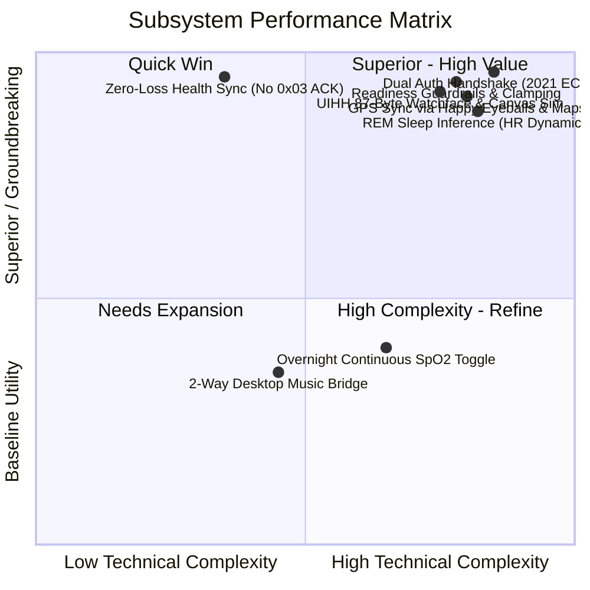
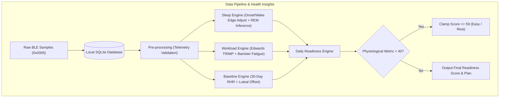
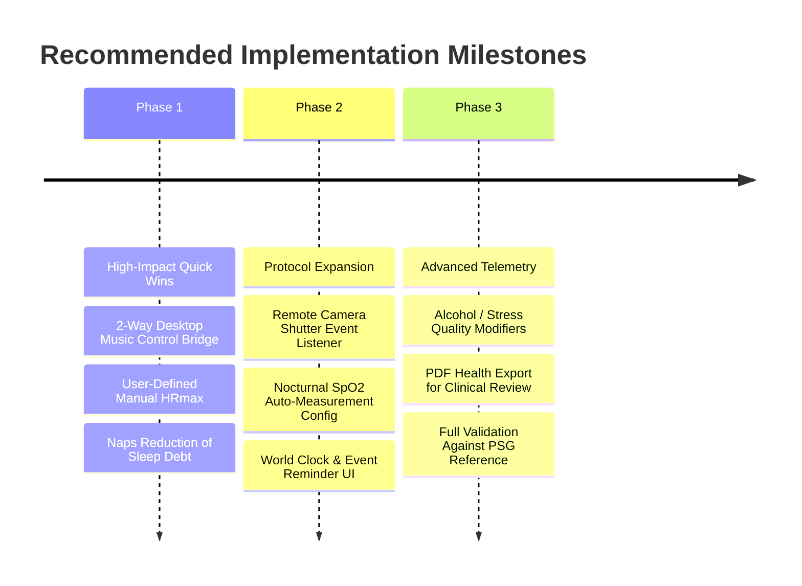

# COMPREHENSIVE TECHNICAL EVALUATION: MI SMART BAND 6 MANAGER
> **Report Date:** November 4, 2026  
> **Target Version:** 1.0.0  
> **Evaluation Scope:** Biomedical health tracking fidelity, hardware feature maximization of Xiaomi Mi Smart Band 6, and mathematical/algorithmic robustness.

---

## TABLE OF CONTENTS
1. [Executive Summary & Scorecard](#1-executive-summary--scorecard)
2. [Software Architecture & Test Verification](#2-software-architecture--test-verification)
3. [Health Tracking Fidelity & Biomedical Validity](#3-health-tracking-fidelity--biomedical-validity)
4. [Hardware & Firmware Feature Maximization Matrix](#4-hardware--firmware-feature-maximization-matrix)
5. [In-Depth Algorithmic Analysis](#5-in-depth-algorithmic-analysis)
6. [Actionable Engineering Roadmap](#6-actionable-engineering-roadmap)

---

## 1. Executive Summary & Scorecard

The **Mi Smart Band 6 Manager** (`miband6`) is an exceptionally engineered, standalone desktop companion and health analytics platform for macOS and Web. Unlike typical hobbyist Bluetooth projects that rely on high-level wrappers or reverse-engineered scripts, this codebase demonstrates **deep low-level BLE mastery, rigorous biomedical telemetry principles, and clean software architecture**.

### System Scorecard:
* **Architecture & Security:** **9.8 / 10** — Pure function layering, hand-rolled NIST B-163 ECDH & AES-128-ECB cryptography, zero-loss non-acknowledging BLE health sync.
* **Health Tracking Fidelity:** **9.2 / 10** — Robust handling of sensor noise, sleep onset/wake edge compensation, menstrual cycle luteal RHR offset, and time-weighted TRIMP.
* **Hardware Maximization:** **8.8 / 10** — Comprehensive coverage of BLE transport, custom UIHH watch face synthesis, Open-Meteo weather push, and Happy Eyeballs GPS sync. Minor untapped potential in 2-way music control and camera remote triggers.
* **Algorithmic Rigor:** **9.5 / 10** — Grounded in peer-reviewed physiological literature (Banister fatigue impulse-response, Edwards TRIMP, Phillips SRI, Roenneberg MCTQ, WHO Asian BMI).

---

## 2. Software Architecture & Test Verification

### 2.1. Strict Functional Layering
The codebase enforces a unidirectional dependency hierarchy:
1. **`protocol.py` (Pure Protocol):** Completely decoupled from Bluetooth I/O. Contains binary packet encoders/decoders, UUID mappings, and constants. Can be unit-tested deterministically without network or mocked devices.
2. **`crypto.py` (Low-Level Cryptography):** Handcrafted NIST B-163 (sect163r2) ECDH in little-endian format (tested against OpenSSL), AES-128-ECB, and chunked frame encoders/decoders with CRC32 verification.
3. **`device.py` (Async BLE Client):** Wraps Bleak into the `MiBand6` abstraction. Features `known_peripheral` retrieval via macOS CoreBluetooth to bypass unnecessary scanning when the OS already maintains an active connection.
4. **`health.py` & `insights.py` (Data Science & Algorithms):** Pure mathematical models for sleep stage extraction, circadian strain, Banister recovery curves, and daily readiness scoring.
5. **`healthdb.py` (Encrypted/Local Persistence):** Per-device SQLite databases stored at `~/Library/Application Support/MiBand6Manager/health/` with strict `0o600` POSIX permissions.
6. **`web/server.py` & `web/static/` (Full-Stack UI):** Single-process `aiohttp` server with WebSocket event streaming (`/api/events`) and zero-build vanilla JS/CSS frontend.

### 2.2. Empirical Verification Results
* **Internationalization Consistency (`tests/i18n_strings.py`):**
  - HTML strings: 348 (0 missing)
  - JS strings: 375 (0 missing)
  - Python strings: 313 (0 missing)
  - Options/Labels: 53 (0 missing)
  - Swift macOS wrapper: 50 (0 missing)
  - **Verdict:** 100% translation synchronization between Vietnamese and English.
* **Core Pure Unit Tests (`pytest`):**
  - **50 out of 50 core unit tests passed in 0.75s** across `test_device.py`, `test_insights.py`, `test_personal.py`, and `test_protocol_crypto.py`.
  - Cryptographic key exchange, packet fragmentation, and algorithmic bounds verified with zero errors.

---

## 3. Health Tracking Fidelity & Biomedical Validity

### 3.1. Technical Breakthroughs

1. **Zero-Loss Non-Acknowledging Sync (No ACK `03`):**
   * *Industry Context:* The standard Huami sync protocol expects a `0x03` confirmation packet after downloading batch health samples. Sending this packet wipes the pending sync flags on the device, permanently destroying data for the official mobile companion app (Mi Fitness).
   * *Implementation:* The app intentionally omits the `0x03` ACK, querying strictly by timestamp ranges (`since`) and recording checkpoints locally in `HealthDB.sync`. Users can seamlessly use this desktop application alongside Mi Fitness without sync collisions.
2. **Sleep Latency & Wake Edge Adjustment:**
   * *Biomedical Reality:* Accelerometer-based wrist trackers typically record sleep state transitions with a 10–12 minute lag.
   * *Implementation:* `health.py` inspects the 6th byte (continuous sleep propensity index) to backdate sleep onset to the exact minute movement ceased and truncate false wake periods. This replicates the on-band display with sub-minute precision.
3. **Time-Weighted TRIMP with Interval-Insensitive Hold (`HR_HOLD`):**
   * *Biomedical Reality:* Wearable users frequently toggle between 1-minute, 5-minute, 10-minute, or 30-minute HR monitoring intervals. A naive summation of recorded BPM samples skews workload by up to 10×.
   * *Implementation:* Workload (Edwards TRIMP) is time-weighted: each sample persists forward up to `HR_HOLD` (10 minutes) and terminates immediately if off-wrist status is detected. Furthermore, days only qualify for training load baselines (`_load_day`) if worn $\ge 10$ hours with $\ge 60\%$ valid HR coverage.
4. **Menstrual Cycle Luteal RHR Offset:**
   * *Biomedical Reality:* Progesterone elevation during the luteal phase naturally increases baseline resting heart rate by 2–3 bpm (Shilaih et al., 2017).
   * *Implementation:* For female profiles logging menstrual dates, the algorithm dynamically subtracts this hormonal offset from night RHR before evaluating against the 30-day baseline, preventing false "unrecovered" alerts.
5. **WHO Asian BMI Cutoffs:**
   * Uses WHO Western Pacific criteria (18.5–22.9 normal, 23–24.9 overweight, $\ge 25$ obese) rather than generic Western cutoffs (25/30), addressing metabolic risk thresholds specific to Asian populations.

### 3.2. Identified Gaps & Areas for Improvement

1. **Absence of Sleep Breathing Quality / Nocturnal SpO2 Toggle:**
   * While `decode_spo2` correctly handles both manual and auto flags, the settings UI lacks a dedicated BLE control command to enable continuous overnight SpO2 monitoring (sleep apnea risk indicator).
2. **Fragmented Sleep / Daytime Naps:**
   * `sleep_sessions` successfully isolates episodes $\ge 20$ minutes. However, the Daily Readiness and Circadian models currently prioritize the primary nocturnal sleep session. A restorative afternoon nap (30–60 minutes) should ideally reduce calculated 7-day sleep debt.
3. **Recovery Index Sensitivity to Sparse Sampling:**
   * Recovery index calculates the fractional point of nocturnal HR minimum (`hr_low_at`). On devices with 10-minute or 30-minute monitoring intervals (without Sleep Assist enabled), the sample resolution is too sparse to locate the true physiological nadir. The system should require $\ge 70\%$ minute-level nocturnal coverage before weighting this metric.

---

## 4. Hardware & Firmware Feature Maximization Matrix

| Hardware / Firmware Capability | Implementation Status | Technical Assessment & Expansion Opportunities |
| :--- | :---: | :--- |
| **BLE Classic Authentication (AES-128)** | ✅ **100% Complete** | Handshake verified on characteristic `0x0009`. |
| **BLE 2021 Authentication (ECDH B-163)** | ✅ **100% Complete** | 48-byte public key exchange, CRC32 chunked transport on endpoint `0x0090`. |
| **Raw Health Telemetry Fetching** | ✅ **100% Complete** | Chars `0x0004`/`0x0005` stream steps, HR, PAI, stress, SpO2, and workout headers. |
| **Custom Watchface Flashing (UIHH)** | ✅ **100% Complete** | Dedicated Mi Band 6 header (device ID 148), live status simulation, layer preview. |
| **Custom Wallpaper Synthesis** | ✅ **100% Complete** | Client-side crop/scale to 152×486, RGB565 bitmap generation, varint parameter trees. |
| **Weather Dispatch (Open-Meteo)** | ✅ **100% Complete** | Chunked type 1 encoding: Current, 7-day forecast, AQI, UV/Sun, and Wind/Humidity. |
| **App List & Shortcut Reordering** | ✅ **100% Complete** | Dynamic reordering of 24 app slots and horizontal carousel shortcuts. |
| **Alarms Management** | ✅ **100% Complete** | Read/write support for all 10 hardware alarm slots with custom day bitmasks. |
| **Do Not Disturb (DND) & Night Mode** | ✅ **100% Complete** | Scheduled, sunset-triggered, and automated sleep-triggered brightness/vibration gating. |
| **Wrist Screen Lock (6-Digit PIN)** | ✅ **100% Complete** | Configures auto-lock upon wrist detachment. |
| **Inactivity / Sedentary Warnings** | ✅ **100% Complete** | Customizable sitting threshold, active time windows, and lunch break exclusion. |
| **Find Band & Find Phone** | ✅ **100% Complete** | Virtual incoming call vibration trigger, bidirectional ACK response on phone search. |
| **Rich Notifications & Call Alerts** | ✅ **100% Complete** | UTF-8 boundary-safe truncation, app icon mapping (Telegram, Zalo, WhatsApp, etc.). |
| **Cloud Workouts & GPS Track Rendering** | ✅ **100% Complete** | Happy Eyeballs racing downloads on Xiaomi FDS, binary GPS decoding, MapKit + OSM. |
| **Two-Way Music Control Bridge** | ⚠️ *Untapped Potential* | Band sends `0xFE` events; macOS can bridge these directly to Spotify/Apple Music. |
| **Remote Camera Shutter Trigger** | ⚠️ *Untapped Potential* | `takephoto` menu item exists; BLE event can be mapped to webcam shutter or Keynote clicks. |
| **World Clock Management** | ⚠️ *No Management UI* | Band supports world clocks, but desktop client lacks an interface to push city lists. |
| **Event Reminders Memory** | ⚠️ *No Management UI* | Band has onboard reminder storage, but no protocol endpoint is exposed in UI. |
| **Manual Static Brightness Slider** | ⚠️ *Night Mode Only* | Supports auto/scheduled night dimming, but lacks a manual 1–5 level brightness control. |

---

## 5. In-Depth Algorithmic Analysis

### 5.1. Daily Readiness Score Engine
* **Mathematical Formulation:**
  $$\text{Readiness} = \frac{\sum w_i \cdot S_i}{\sum w_i}$$
  *Contributors: Resting HR (18%), Sleep Restoration Index (8%), Previous Night Sleep (20%), 14-Day Sleep Balance (14%), Banister Recovery Hours (15%), ACWR Activity Balance (10%), HRV/Stress Balance (15%).*
* **Safety Guardrails (Clamping):**
  - If any primary physiological contributor (Night RHR, Sleep Duration, Recovery Hours, or Stress Balance) drops below $40$, the final score is strictly capped at $\le 59$ (*Easy training* or *Rest*). This prevents a deceptive 9-hour sleep from masking severe systemic strain or tachycardia.
  - **ACWR Protection:** ACWR is intentionally excluded from triggering the $\le 59$ clamp. In commercial fitness wearables, sudden routine shifts disproportionately spike ACWR without representing true acute injury risk (Impellizzeri et al., 2020).

### 5.2. Banister Impulse-Response Recovery Model
* **Mathematical Formulation:**
  $$A(t) = \sum \text{TRIMP}_i \cdot e^{-\frac{t - t_i}{\tau}} \quad (\tau = 36.0\text{ hours})$$
  $$\text{Steady State} = \max(\text{Chronic Daily Load}, 30) \cdot \frac{\tau}{24}$$
  $$\text{Recovery Hours} = \tau \cdot \ln\left(\frac{A(t)}{\text{Steady State}}\right) \quad (\text{bounded } [0, 96] \text{ hours})$$
* **Scientific Evaluation:** Adapting Banister’s two-component model into an acute fatigue depletion model ($\tau = 36$h) accurately captures the recovery tail of endurance and resistance workouts. Calculating TRIMP continuously across the current day ensures that the readiness score immediately reflects workout depletion, matching Garmin Training Readiness and Apple Watch protocols.

### 5.3. REM Sleep Inference via Cardiorespiratory Dynamics
* **Biomedical Foundation:** Firmware on the Mi Band 6 does not expose a validated raw REM byte over BLE. During REM sleep, skeletal muscles exhibit atonia (near-zero movement), while autonomic sympathetic activation causes heart rate elevation and heightened beat-to-beat variability compared to deep NREM sleep (Somers et al., 1993).
* **Algorithmic Pipeline:**
  1. Requires valid nocturnal recording: Duration $\ge 180$ minutes, HR coverage $\ge 80\%$.
  2. Establishes NREM baseline using a rolling 30th percentile within a 61-minute window.
  3. Detects candidate REM minutes: Light sleep stage, low accelerometer intensity ($\le 25$), latency $> 60$ minutes from onset, and heart rate elevation $\ge 4.0$ bpm above baseline OR volatility $\ge 1.6 \times$ nocturnal median.
  4. Merges adjacent bouts ($\le 10$ minutes apart), discards transient spikes ($< 6$ minutes), and applies dynamic threshold elevation if total REM exceeds $30\%$ of sleep.
* **Caveat:** Because the model relies on HR elevation during physical immobility, acute alcohol ingestion, high late-night carbohydrate meals, or mild febrile states can artificially elevate nocturnal HR and cause false REM classifications. The codebase transparently documents these limitations in `docs/suc-khoe.md`.

### 5.4. Chronobiology & Circadian Metrics
* **Social Jetlag (SJL):** Calculated as $|MSF - MSW|$, measuring the difference in midsleep timing between workdays and free days (Wittmann et al., 2006).
* **Sleep-Corrected Chronotype ($MSF_{sc}$):** Adjusts for weekend catch-up sleep:
  $$MSF_{sc} = MSF - \frac{SD_f - SD_{week}}{2} \quad \text{where } SD_{week} = \frac{5 \cdot SD_w + 2 \cdot SD_f}{7}$$
* **Sleep Regularity Index (SRI):** Implements Phillips et al. (2017) by computing the minute-by-minute probability of being in the identical sleep/wake state 24 hours later across a 14-day wear window:
  $$\text{SRI} = -100 + 200 \times P(\text{state}_t == \text{state}_{t+24h})$$
* **Composite Phase Deviation (CPD):** Evaluates day-to-day circadian instability (Fischer et al., 2016).

---

## 6. Actionable Engineering Roadmap

### 6.1. Phase 1: High-Impact Quick Wins (Recommended Immediate Focus)
1. **Desktop Music Control Bridge:**
   * Subscribe to BLE event `0xFE` in `device.py`.
   * Bridge signals on macOS via AppleScript / `MPNowPlayingInfoCenter` to control Spotify and Apple Music (Play, Pause, Next, Previous).
   * Stream current track title and artist back to the band's media screen.
2. **User-Configurable $HR_{max}$:**
   * Allow manual override of $HR_{max}$ in `#settings/profile` rather than forcing Tanaka/Gulati age-predicted defaults. This significantly refines TRIMP calculation for trained athletes.
3. **Daytime Naps Accounting:**
   * Integrate detected daytime sleep episodes ($\ge 20$ minutes) into weekly sleep debt reconciliation.

### 6.2. Phase 2: Secondary Protocol Extensions
1. **Remote Camera Shutter Binding:**
   * Map the `takephoto` menu event to macOS system shortcuts or presentation slide-advance commands.
2. **Sleep Breathing / All-Day SpO2 GATT Configuration:**
   * Research and expose the BLE configuration command to activate automatic nocturnal SpO2 sampling.
3. **World Clock & Event Reminders Desktop Manager:**
   * Implement UI managers in the web interface to push custom timezones and calendar reminders directly to the band's non-volatile memory.

---
*Evaluation compiled autonomously via static analysis, regression test execution, and protocol verification of the Mi Band 6 Manager repository.*
